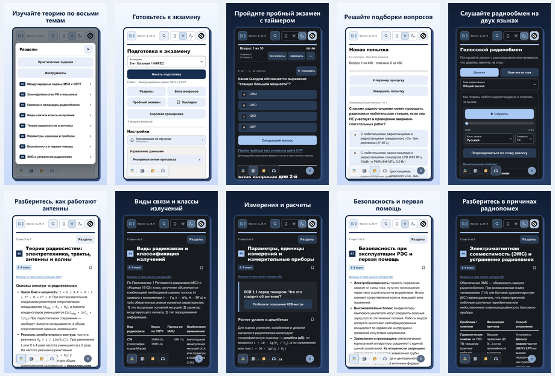

  

# Радиоэкзамен для Android и ПК

Приложение помогает самостоятельно подготовиться к квалификационному экзамену радиолюбителя на 1–4-ю категории. Выберите свою категорию, изучайте теорию, отвечайте на вопросы и проверяйте готовность на пробном экзамене с таймером. Учебные материалы, задания и аудио доступны без интернета.

## Теория и практика

Изучайте восемь тем: от международных норм, правил радиообмена и позывных до антенн, измерений, электробезопасности и радиопомех. В каждом разделе есть самопроверка с объяснениями. Тренажеры помогают освоить фонетический алфавит, Q-коды и классы излучений, а практические задания предлагают закрепить теорию.

## Вопросы и повторение

Ищите вопросы по номеру или формулировке, выбирайте тему и возвращайтесь к своим ошибкам. Тренировка «5 вопросов на сегодня» помогает уделить время слабым темам. В разделе «Повторить сегодня» собраны вопросы, которые пора повторить.

## Пробный экзамен

Пройдите билет по условиям выбранной категории. Таймер показывает оставшееся время, а сетка вопросов помогает вернуться к пропускам. После завершения можно разобрать ответы, перейти к нужной теории и сравнить результаты с предыдущими попытками. Отчет с именем и фамилией кандидата можно сохранить отдельным HTML-файлом.

## Голосовой радиообмен

Послушайте пять типичных радиолюбительских диалогов на русском и английском: общий вызов, повтор позывного при помехах, обмен рапортами, проверка занятости частоты и связь на соревнованиях. Меняйте скорость записи, переходите к любой реплике и сверяйтесь с расшифровкой и разбором.

## Учеба в своем темпе

Сохраняйте закладки, продолжайте чтение с последнего места и пользуйтесь поиском по справочнику. Прогресс сохраняется на устройстве. Напоминания по умолчанию выключены. При желании можно задать время и периодичность.

## Справочник на ПК

Обычная сборка выпуска сохраняет `ham_prepare_ru.html` рядом с подписанным APK в `android/releases/<версия>/`. Откройте HTML-файл в браузере двойным щелчком. Главы, поиск, вопросы, тренировки, пробный экзамен и встроенное аудио работают без интернета.

После обычной сборки та же версия справочника публикуется на [hamprep.ssotnikov.pro](https://hamprep.ssotnikov.pro/). Прогресс на сайте сохраняется в текущем браузере. Сохраненный HTML-файл можно открывать без сети отдельно.

В Edge и Chrome справочник с сайта можно установить через меню браузера и открывать в своем окне. После первой полной загрузки установленный справочник работает и без сети. Прогресс сайта доступен в установленном приложении при использовании того же профиля браузера.

Перед переходом на новый файл откройте прежнюю версию и в разделе «Настройки» → «Резервная копия прогресса» сохраните копию. Затем откройте новый HTML в браузере, загрузите копию через тот же раздел, сверьте предварительный просмотр и подтвердите восстановление. Так же можно перенести прогресс между ПК и Android.

## Авторы и контакты

- Сергей Сотников, эксперт по кибербезопасности СберТех [@ssotnikov в Telegram](https://t.me/ssotnikov)
- Вадим Федоров R2BMX, старший преподаватель кафедры КБ-1 РТУ МИРЭА [@r2bmx в Telegram](https://t.me/r2bmx)

## Лицензия

Проект использует [лицензию MIT](LICENSE.md). Она разрешает использовать, изменять и распространять программу, в том числе в коммерческих целях, при сохранении уведомлений об авторских правах и лицензии. Программа предоставляется без гарантий.
