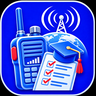

# Приложение Радиоэкзамен для Android



«Радиоэкзамен» помогает самостоятельно подготовиться к квалификационному экзамену радиолюбителя на **1–4-ю категории**. В справочнике есть теория с самопроверкой, блок экзаменационных вопросов и пробный билет с таймером. Справочник открывается в браузере, а приложение для Android работает офлайн и хранит прогресс на устройстве.

## Быстрый старт

- **В браузере.** Скачайте исходный файл [ham_prepare_ru.html](html/ham_prepare_ru.html) и откройте его локально. Сборка не требуется.
- **На Android 8.0 и новее.** Установите подписанный `hamprepru.apk` из поставки проекта. Путь к файлу, версия, контрольная сумма SHA-256 и изменения указаны в [журнале выпусков](docs/releases.md).

Выберите категорию на главной странице и откройте **«Учиться»**, **«Блок вопросов»** или **«Пробный экзамен»**.

## Что можно делать

- **Учиться.** Восемь тем охватывают нормы МСЭ и CEPT, законодательство и позывные, радиообмен, виды связи и классы излучений, радиосистемы и антенны, измерения, безопасность и первую помощь, ЭМС и радиопомехи. Есть самопроверка, тренажеры позывных, фонетического алфавита, Q-кодов и классов излучений, калькуляторы антенн и КСВ и конвертер децибелов.
- **Тренироваться на вопросах.** Общий перечень содержит 426 вопросов. Блок показывает вопросы выбранной категории и позволяет искать по номеру или формулировке, фильтровать по теме и повторять ошибки.
- **Закреплять слабые темы.** «5 вопросов на сегодня» предлагает короткую тренировку по ошибкам и вопросам без ответа. Из разбора экзамена ее можно запустить по конкретной теме.
- **Повторять ошибки через несколько дней.** «Повторить сегодня» показывает в блоке вопросов, что пора повторить. Очередь работает без сети и при выключенных уведомлениях.
- **Возвращаться к материалам.** «Продолжить чтение» открывает последнее место в выбранной категории. Закладки ведут к сохраненным разделам, таблицам, формулам и отдельным вопросам.
- **Слушать радиообмен.** Пять учебных диалогов на русском и английском с автономным аудио, расшифровкой по репликам и разбором.
- **Сравнивать попытки.** История хранит до 20 результатов по каждой категории. Можно выбрать источник вопросов, посмотреть динамику баллов и повторяющиеся ошибки по темам.
- **Применять теорию.** 12 практических мини-сценариев по радиообмену, измерениям и радиопомехам с разбором и переходом к теории.
- **Сохранять результаты.** «Экспорт в HTML» создает автономный файл с именем и фамилией кандидата из протокола или истории. Имя и фамилию можно изменить при следующем экспорте.
- **Пройти пробный экзамен.** Таймер и сетка вопросов помогают следить за билетом. По окончании видны верные, неверные и пропущенные ответы. При истечении времени приложение учитывает ответы, данные до дедлайна.

Поиск по всему справочнику открывается лупой в верхней панели. Там же можно выбрать светлую, темную или системную тему. Для сброса прогресса требуется подтверждение.

## Условия пробного экзамена

| Категория | Вопросов в блоке | Вопросов в билете | Верных для зачета | Время |
| --- | ---: | ---: | ---: | ---: |
| 1-я | 426 | 45 | 40 | 90 мин |
| 2-я | 405 | 30 | 25 | 60 мин |
| 3-я | 218 | 25 | 20 | 60 мин |
| 4-я | 201 | 20 | 15 | 60 мин |

Для 1-й категории прием азбуки Морзе проверяется отдельно от теории. Положение об экзамене, перечень вопросов и образцы телеграфного текста доступны [на сайте Союза радиолюбителей России](https://srr.ru/radiooperatoram/kvalifikatsionnyj-ekzamen-2-2/).

## Материалы и курсы

Основа справочника — «Экзаменационный справочник радиолюбителя» А. Н. Замороки (UA0C, 2020), приказ Минкомсвязи России № 184 и [перечень экзаменационных вопросов по приказу от 01.10.2015 № 224](https://r9c.srr.ru/wp-content/uploads/2026/02/exam-voprosy2023.pdf).

- [Онлайн-тестирование Союза радиолюбителей России](https://exam.srr.ru/)
- [Курс Stepik «Сдаем на радиолюбительскую категорию»](https://stepik.org/course/261540)
- [Курс Stepik «Сдаем на 2 и 1 радиолюбительскую категорию (продвинутый уровень)»](https://stepik.org/course/269756)

В окне «О приложении» указана дата нормативной сверки **19 ноября 2026 года** и приведены ссылки на документы.

- [Статья 22 закона № 126-ФЗ «О связи»](https://base.garant.ru/186117/94f5bf092e8d98af576ee351987de4f0/)
- [Правила регистрации по постановлению № 1800](https://www.consultant.ru/document/cons_doc_LAW_398978/ffd04ed565c43935c477313aa9ed8815a1d660ce/)
- [Приказ № 4 о позывных](https://base.garant.ru/70156402/)
- [Приказ № 184 о работе любительской службы](https://base.garant.ru/57412959/)
- [Решение ГКРЧ № 10-07-01 в редакции № 18-45-02](https://www.garant.ru/products/ipo/prime/doc/71829332/)
- [Приказ Минздрава № 220н](https://base.garant.ru/409112510/)

## Авторы и контакты

- Сергей Сотников, эксперт по кибербезопасности в СберТехе. [@ssotnikov в Telegram](https://t.me/ssotnikov)
- Вадим Федоров R2BMX, старший преподаватель кафедры КБ-1 РТУ МИРЭА. [@r2bmx в Telegram](https://t.me/r2bmx)

## Разработка

Основной файл — [HTML-справочник](html/ham_prepare_ru.html). В каталоге [android](android/) находятся оболочка WebView и скрипт сборки. Поведение приложения описано в [спецификациях OpenSpec](openspec/specs/).

Для проверки состава экзаменационных вопросов и ключа ответов достаточно Node.js.

```powershell
node android/verify-exam-data.mjs
```

Для локальной сборки под Windows нужны PowerShell 7.2+, Node.js с npm, JDK и Android SDK с Build Tools 36.0.0 и платформой Android 36 или 37.0. Чтобы сохранить экземпляры переданных выпусков, укажите временный путь для APK.

```powershell
./android/build.ps1 -Output "$env:TEMP/hamprepru-local.apk"
```

Порядок работы с проектом описан в [правилах участия](CONTRIBUTING.md), [политике безопасности](SECURITY.md) и [правилах версионирования](SEMVER.md).

## Лицензия

Проект использует [лицензию MIT](LICENSE.md). Она разрешает использовать, изменять и распространять программу, в том числе в коммерческих целях, при сохранении уведомлений об авторских правах и лицензии. Программа предоставляется без гарантий.
