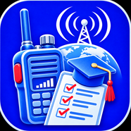
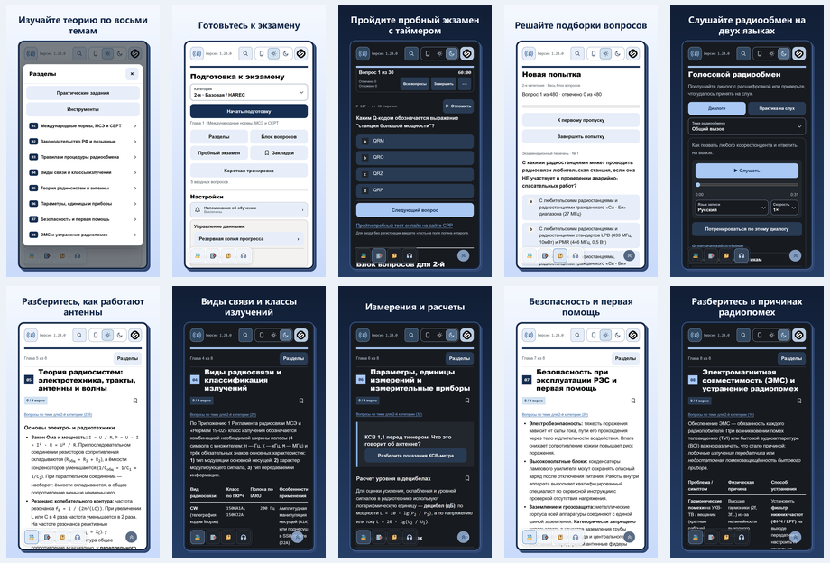

  

# Радиоэкзамен для Android и ПК

Приложение помогает подготовиться к квалификационному экзамену радиолюбителя на 1–4-ю категории. Выберите свою категорию, изучайте теорию, отрабатывайте радиообмен и проверяйте готовность на пробном экзамене. Учебные материалы, задания и встроенное аудио доступны без интернета.

**Текущий выпуск 1.24.0** · [Скачать подписанный APK или автономный HTML](https://github.com/ssotnikov/hamprep/releases/tag/v1.24.0) · [Открыть справочник в браузере](https://hamprep.ssotnikov.pro/)

## Теория и практика

- **Восемь тем** охватывают международные нормы, российские правила, радиообмен, классы излучений, антенны, измерения, безопасность и радиопомехи. В главах есть вопросы для самопроверки с объяснениями.
- **Практические задания** помогают составить радиообмен, проверить запись в журнале и разобраться с показаниями КСВ-метра. Из заданий можно перейти к связанной теории.
- **Справочники и инструменты** включают русский и английский **фонетические алфавиты**, **Q-коды**, **декодер классов излучений**, **конвертер децибел** и **анализатор позывных**. Анализатор позволяет разобрать детали введенного позывного и выдает ссылки на внешние реестры для дополнительной проверки.

## Вопросы и повторение

В блоке вопросов можно выбрать экзаменационный перечень или учебные вопросы, найти вопрос по номеру или формулировке и отфильтровать список по теме или своим ошибкам. Перед началом прохода видно, какие вопросы попадут в выборку. **«Карта пробелов по темам»** показывает ошибки и пропуски, **«Короткая тренировка»** предлагает небольшую подборку, а **«Повторить сегодня»** возвращает к вопросам, для которых пришло время повторения.

## Пробный экзамен

Пройдите билет по условиям выбранной категории. Таймер показывает оставшееся время, а сетка вопросов помогает вернуться к пропускам. После завершения можно разобрать ответы, открыть нужную теорию, сравнить результаты в истории попыток и экспортировать отчет в HTML.

В памятке перед реальной сдачей собраны условия экзамена и вопросы, которые стоит уточнить у комиссии. Для 1-й категории рядом с условиями пробного экзамена доступна отдельная **тренировка приема Морзе** на слух с проверкой по символам.

## Голосовой радиообмен

Послушайте пять типичных радиолюбительских диалогов на русском и английском, от общего вызова до связи на соревнованиях. Можно менять скорость записи, переходить к отдельным репликам и открывать расшифровку. В режиме **«Практика на слух»** нужно распознать данные из записи эфира и проверить свой ответ.

## Учеба в своем темпе

Сохраняйте закладки, продолжайте чтение с последнего места и ищите по справочнику с указанием главы текущего совпадения. Прогресс хранится на устройстве или в текущем профиле браузера. В Android можно включить напоминания об обучении и выбрать время и периодичность.

## Справочник в браузере и без сети

Справочник подходит для настольных и мобильных браузеров. 

Загрузите [hamprep.html с GitHub](https://github.com/ssotnikov/hamprep/blob/main/html/hamprep.html) и откройте его прямо в браузере. На странице файла нажмите кнопку скачивания. Главы, поиск, вопросы, тренировки, пробный экзамен и встроенное аудио работают без интернета. Обычная сборка сохраняет этот файл рядом с подписанным APK в `android/releases/<версия>/`.

В Edge и Chrome справочник с сайта можно установить как приложение через меню браузера и открывать в своем окне. После первой полной загрузки установленный справочник работает и без сети. Прогресс сайта доступен в установленном приложении при использовании того же профиля браузера.

Перенести прогресс между устройствами возможна через раздел **«Настройки» → «Резервная копия прогресса»**.

## Авторы и контакты

- Сергей Сотников, эксперт по кибербезопасности СберТех [@ssotnikov](https://t.me/ssotnikov)
- Вадим Федоров R2BMX, старший преподаватель кафедры КБ-1 РТУ МИРЭА [@r2bmx](https://t.me/r2bmx)

## Лицензия

Проект использует [лицензию MIT](LICENSE.md). Она разрешает использовать, изменять и распространять программу, в том числе в коммерческих целях, при сохранении уведомлений об авторских правах и лицензии. Программа предоставляется без гарантий.
